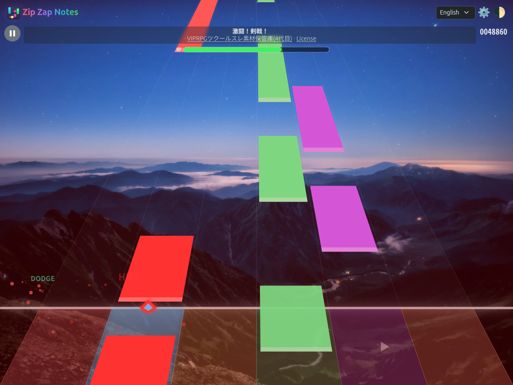
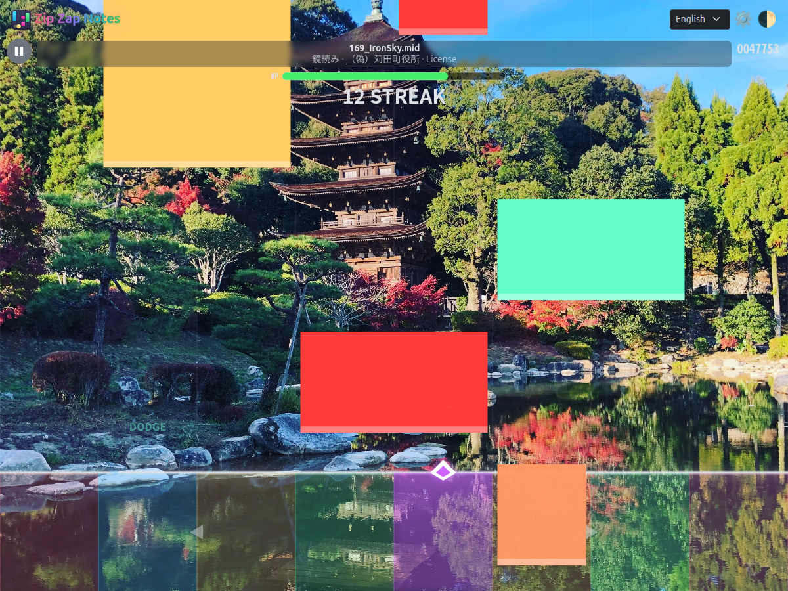
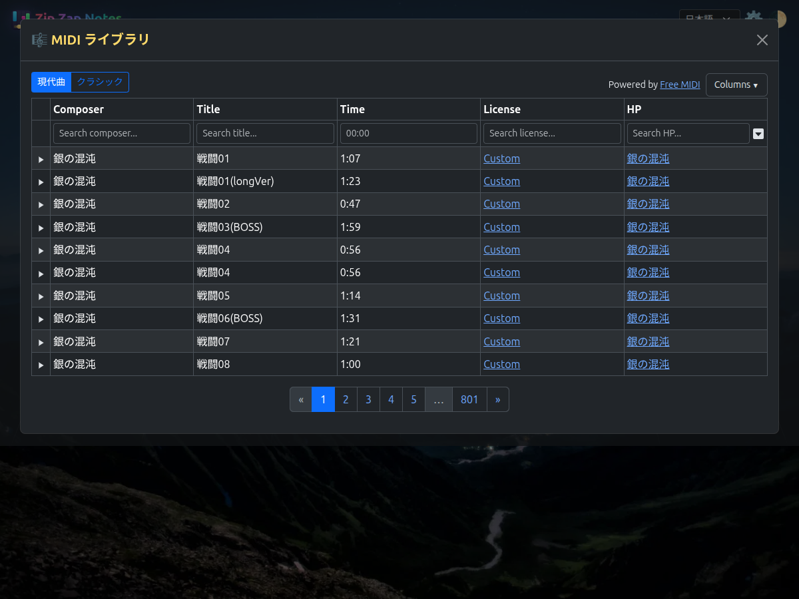
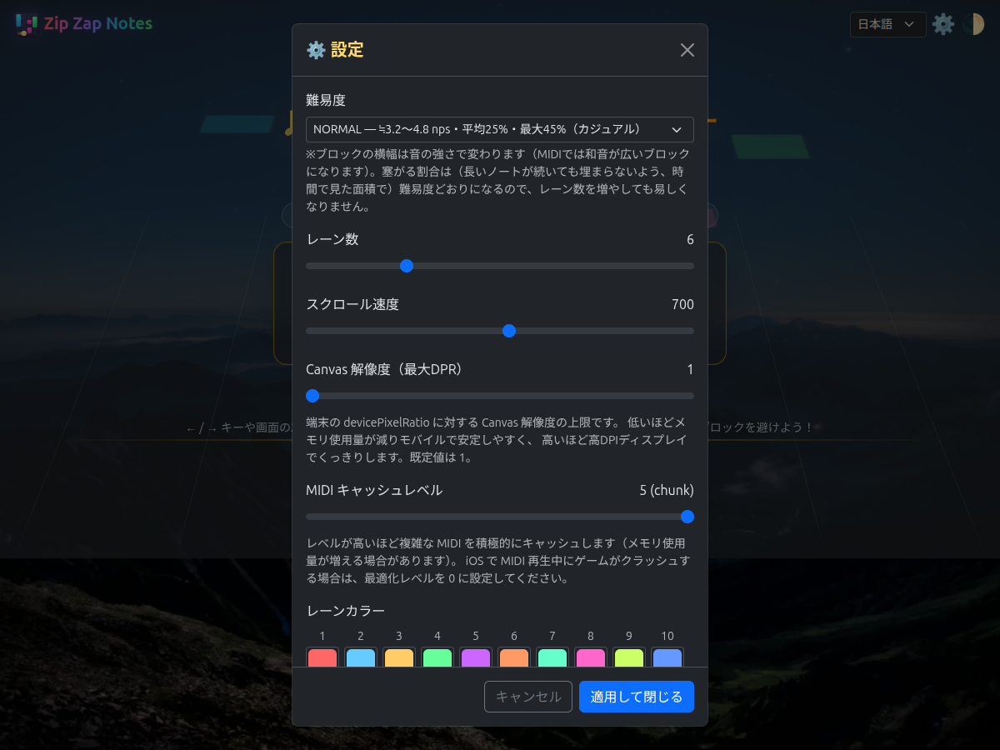
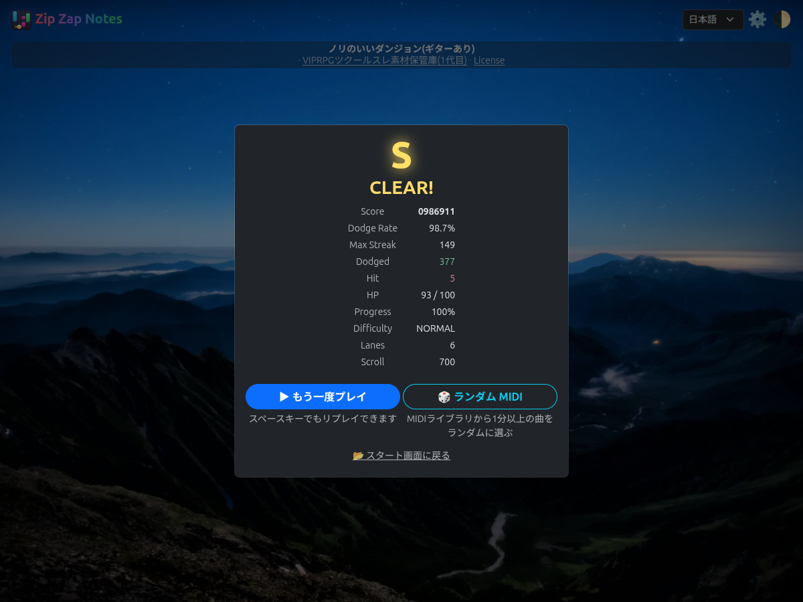
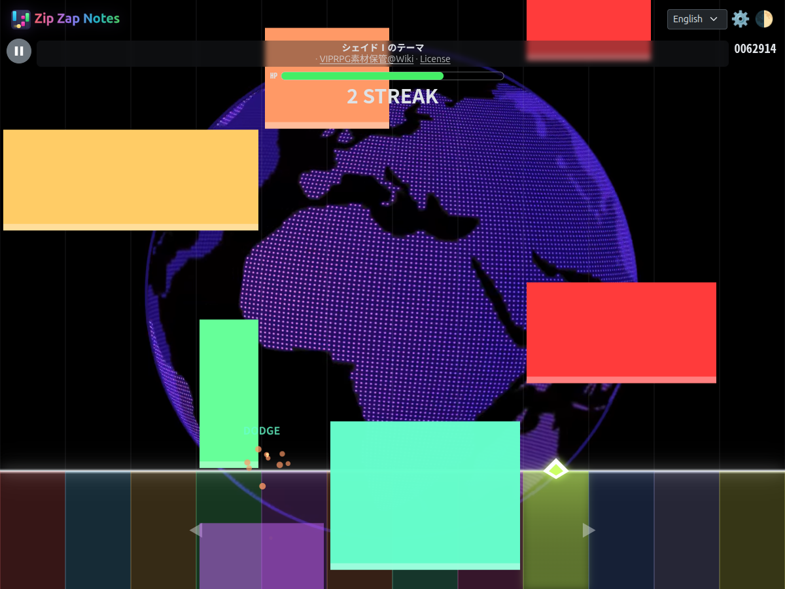
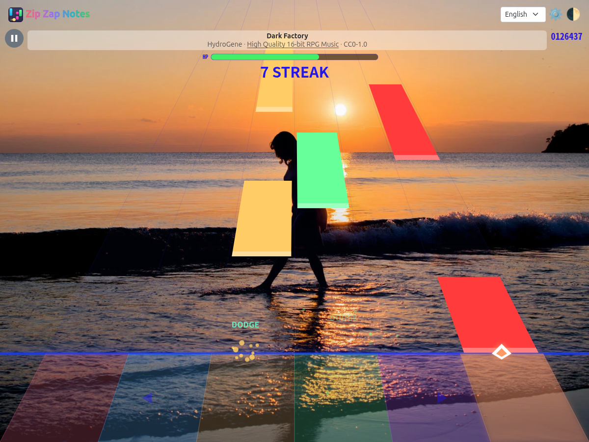
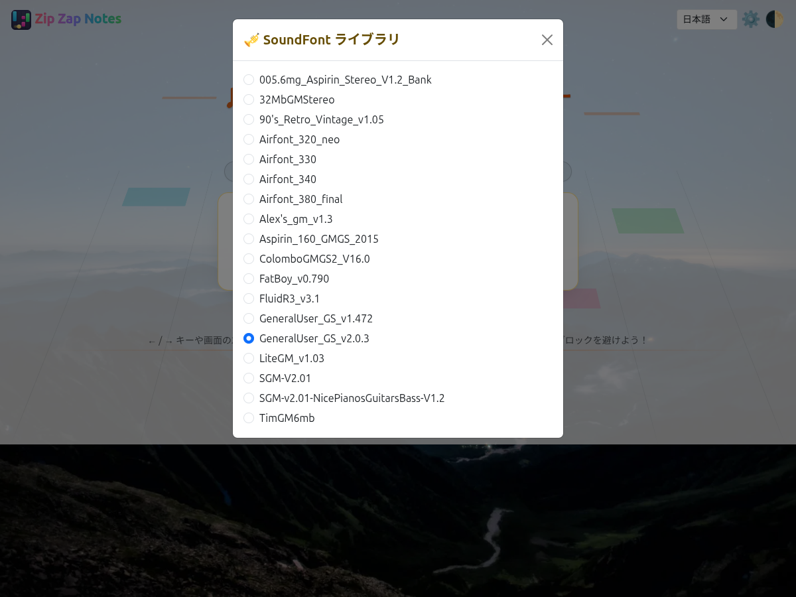
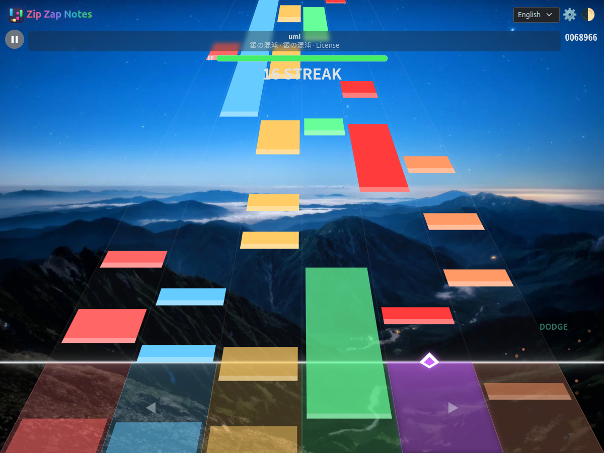

# Zip Zap Notes

A browser-based falling-note rhythm game that automatically generates charts
just by loading music files (MP3/WAV/OGG, etc.). Move left and right to avoid
the falling blocks and survive to the end of the song before your HP runs out.
You can also play MIDI files directly and change the sound source using
SoundFonts (SF2/SF3).

- [フリーゲーム夢現](https://freegame-mugen.jp/puzzle/game_15871.html)
- [itch.io](https://marmooo-games.itch.io/zip-zap-notes)

## Screenshots

Title Screen 

Gameplay Screen - With Perspective


Gameplay Screen - Without Perspective


MIDI Library 

Settings Screen 

Score Screen 

Customization - Background


Customization - Notes/Lanes


Customization - SoundFont 

Customization - Difficulty/Speed


## Build

```
bash build.sh
```
